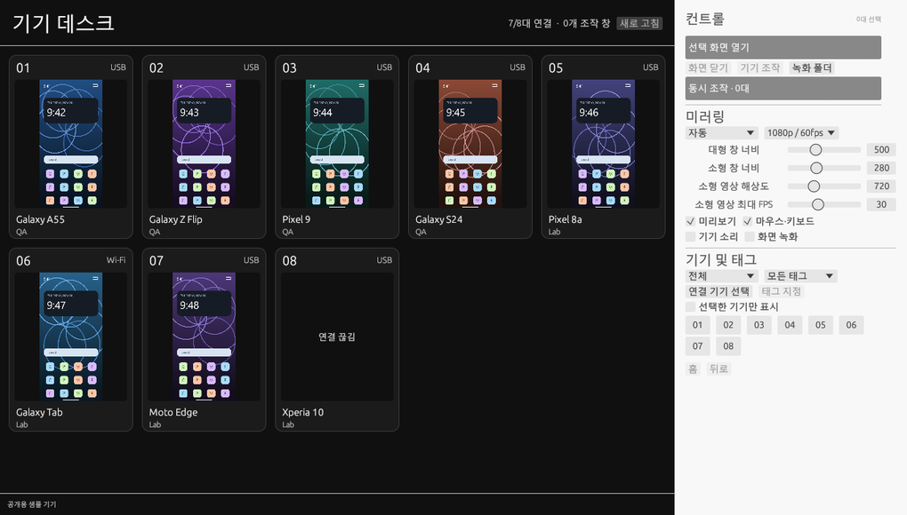
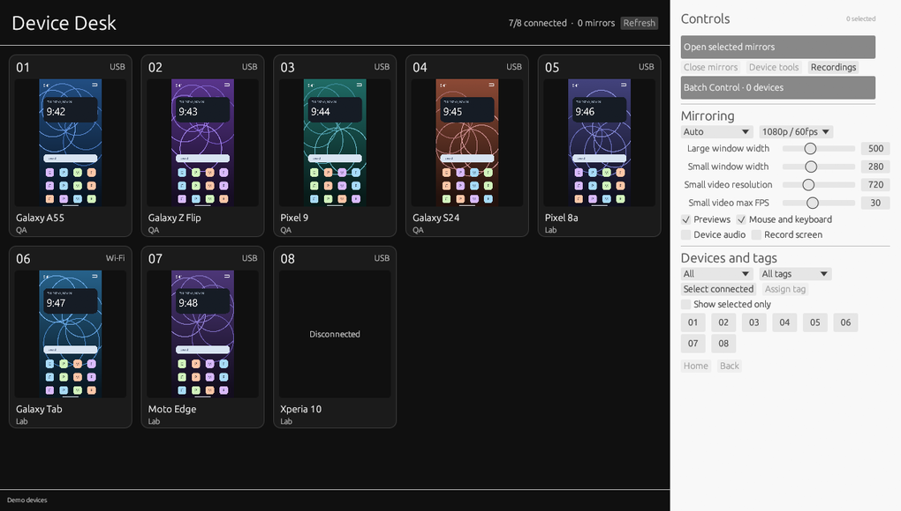
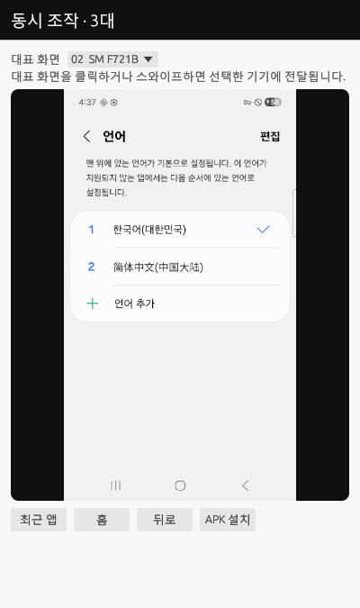
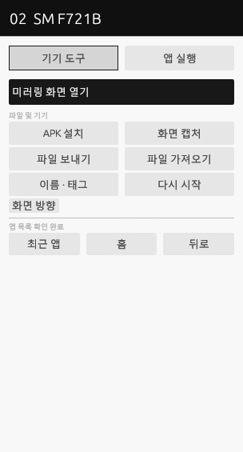
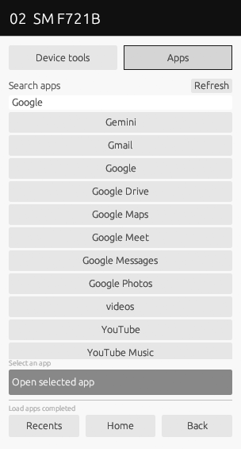
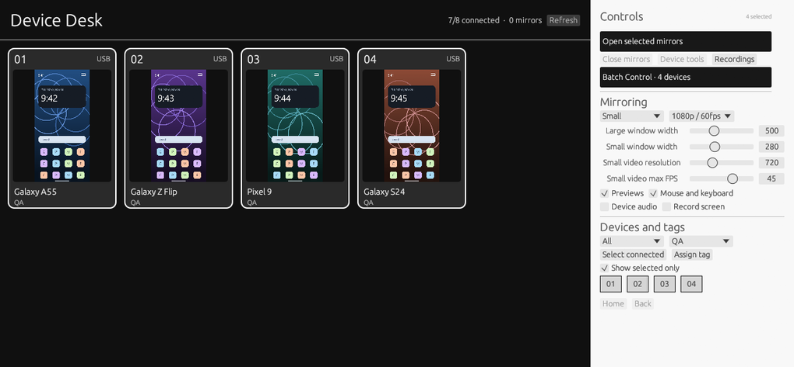

# Android Device Desk

[한국어](README.md) · [Windows download](https://github.com/hardline7/AndroidDeviceDesk/releases/latest)

**Android Device Desk is a Windows desktop app for mirroring and controlling multiple Android devices.** Drag across the device grid to select several phones, then use a representative screen to send the same tap or swipe to the group. Open a separate full-size mirror and control panel when you need to work on one device. The interface follows the Windows display language and uses English for all display languages other than Korean.

> The source build includes USB Internet sharing, automatic batch-window opening, and Windows display-language detection. In release v0.1.0, click **Batch Control** after dragging.

## Screenshots

Captured with sample devices. Select a thumbnail to open the larger image.

| Korean dashboard | English dashboard |
| --- | --- |
| <a href="docs/screenshots/dashboard-ko.png"></a> | <a href="docs/screenshots/dashboard-en.png"></a> |

| Batch control | Individual device tools | App search and launcher |
| :---: | :---: | :---: |
| <a href="docs/screenshots/batch-control.png"></a> | <a href="docs/screenshots/device-tools.png"></a> | <a href="docs/screenshots/app-launcher.png"></a> |

**Device filters and tags** · The QA tag narrows the grid and keeps the small-window settings in view.

<a href="docs/screenshots/device-filters.png"></a>

## Features

| Feature | How it works |
| --- | --- |
| Device grid | Preview connected displays on cards. Saved device numbers and names are kept when devices go offline. |
| Multi-selection | Drag a rectangle over the grid. Ctrl+drag adds devices to the selection, and Shift+click selects a range. |
| Batch control | Choose a representative display to send taps and swipes to the selected devices. Recents, Home, Back, and batch APK installation are available. |
| Individual mirroring | Double-click a card or use **선택 화면 열기** (Open selected screens). Control the device with a mouse and keyboard. |
| Device tools | Capture screenshots, install APKs, transfer files in the device's Download folder, change orientation, reboot, and find or launch apps. |
| View-only and recording | Disable mouse and keyboard control before opening a mirror for view-only use. Supported devices can forward audio and record to MKV. |
| Organization | Find devices by number, alias, tag, or connection type. Adjust window width, resolution, and maximum frame rate. |
| USB Internet sharing | Give USB-connected Android devices access to the PC’s Internet connection. Approve the VPN prompt on each device the first time. |
| Local API | Run a sequence of site, app, tap, and swipe actions on one device, several devices, or all connected devices. [API guide](docs/API.md) |

## Download and connect

1. Download **AndroidDeviceDesk.exe** from the [latest release](https://github.com/hardline7/AndroidDeviceDesk/releases/latest).
2. Run the EXE on 64-bit Windows. The first run extracts the bundled engine to your local app data folder. Python and manual archive extraction are unnecessary.
3. Enable **Developer options → USB debugging** on the phone. On many Galaxy devices, you can reveal Developer options by tapping **Build number** seven times under **Settings → About phone → Software information**. Labels vary by model and language.
4. Connect the phone with a USB cable that supports data. Unlock it and approve the USB debugging prompt.
5. Double-click the device card to open a mirror. Use **새로 고침** (Refresh) to refresh discovery manually.

Use devices for which you can authorize USB debugging. Some setups require a Windows USB driver from the device manufacturer. Existing Wi-Fi ADB connections are also discovered. Set up new wireless-debugging pairs on Android and through ADB before opening them here.

To verify the downloaded executable, compare its SHA-256 with `SHA256SUMS.txt` on the release page.

```powershell
Get-FileHash .\AndroidDeviceDesk.exe -Algorithm SHA256
```

## Control several devices at once

1. Drag a rectangle over two or more connected cards. You can also use the numbered buttons on the right.
2. **Batch Control** opens automatically when you release the mouse after dragging. If you used the numbered buttons, click **Batch Control** on the right. The window uses the selection that was active when it opened.
3. Choose **대표 화면** (Representative screen). Click inside the image to send a tap or drag inside it to send a swipe. The surrounding padding does not accept screen input.
4. Use the bottom buttons for **Recents**, **Home**, **Back**, or **Install APK**. Batch APK installation begins after you choose the file and confirm.
5. Check the completion count in the window. To change the target group, drag across the new devices in the grid.

Tap and swipe locations are relative to the representative image and are mapped to each device's resolution. For predictable results, put devices on the same screen or in the same app first. Devices with a different screen orientation are skipped for gestures. Disconnected and view-only targets do not receive batch control commands. Operations are sent in parallel and completion times can vary by device.

## Individual device control and mirroring

- Select one connected card to open **기기 조작** (Device controls). The panel moves beside the mirror when you start mirroring.
- **기기 도구** (Device tools) provides PNG screenshots, APK installation, file transfers to and from `Download`, orientation changes, and a confirmed reboot.
- **앱 실행** (Apps) supports search by friendly name or package ID. Common Android settings are available as shortcuts.
- The **자동** (Auto) window mode uses the small-window settings when you open three or more devices together. You can explicitly choose large or small mode. New settings apply to mirrors opened afterward.
- Enable **화면 녹화** (Screen recording) before starting a mirror to save MKV files under `%USERPROFILE%\Videos\Android Device Desk`. Close the mirror to finish the recording.
- Turning **미리보기** (Previews) off stops grid capture. An open batch-control window continues refreshing the representative display for input.

## Share the PC’s Internet over USB

1. Select one or more USB-connected devices with debugging authorized. Make sure the PC has Internet access.
2. Open **USB Internet sharing** and choose **Enable for selected**. Device Desk installs the bundled Gnirehtet companion app when needed.
3. Unlock each phone and approve the **Gnirehtet VPN** request. Check for **VPN running** in Device Desk.
4. With Wi-Fi and mobile data disabled, open a website in the phone’s browser. Choose **Disable for selected** or **Disable all** to end sharing.

Keep Device Desk running and the USB cable connected. Sharing uses Android’s VPN facility, so an existing VPN may need to be switched. Gnirehtet relays IPv4 TCP and UDP. If a device is unplugged, reconnect it and enable sharing again. [Gnirehtet documentation](https://github.com/Genymobile/gnirehtet/tree/v2.5.1)

## Architecture and local data

| Component | Role |
| --- | --- |
| Rust and egui/eframe | Windows interface, preview grid, multi-selection, settings, and device panels |
| ADB | Device discovery, screenshots, touch and key input, application queries, APK installation, and file transfer |
| scrcpy | Live video, audio, individual-device control, and recording |
| Local storage | Engine files, names, tags, and window settings in `%LOCALAPPDATA%\AndroidDeviceDesk` |

The app merges discovery from the default ADB connection and an already running local secondary ADB server at `127.0.0.1:5038`. If a device appears in both, it is listed once. Preview and control commands use the connection associated with each device. The app does not start the optional secondary server.

Preview images are held in PC memory. Screenshots and recordings are saved locally when requested. The app requires no account or cloud service. Wi-Fi ADB traffic follows the device connection you configured.

## Build from source

On Windows x64, install [Rust](https://rust-lang.org/install/) and the **Desktop development with C++** workload from [Visual Studio Build Tools](https://visualstudio.microsoft.com/downloads/) for the default MSVC toolchain. The supplied release was built using the Rust 1.100 GNU toolchain.

```powershell
git clone https://github.com/hardline7/AndroidDeviceDesk.git
cd AndroidDeviceDesk
powershell -ExecutionPolicy Bypass -File .\scripts\build.ps1
```

The script downloads the official Windows scrcpy and Gnirehtet archives, checks their SHA-256 hashes, and builds the Rust release with the committed dependency lockfile. It writes `dist\AndroidDeviceDesk.exe`. After building, run the tests with:

```powershell
cargo test --locked --release --manifest-path .\rust-app\Cargo.toml
```

| Path | Responsibility |
| --- | --- |
| `rust-app/src/main.rs` | Dashboard, preview grid, rectangle selection, and window state |
| `rust-app/src/panel.rs` | Individual device actions, app search and launch, and file tools |
| `rust-app/src/batch.rs` | Representative-screen input, coordinate conversion, and parallel dispatch |
| `rust-app/src/engine.rs` | Embedded runtime setup, ADB discovery and routing, image capture, and mirroring integration |
| `rust-app/src/tether.rs` | Gnirehtet relay and USB reverse tethering lifecycle |
| `scripts/build.ps1` | Download and verify the official runtime archive, then build the single EXE |

## Troubleshooting

| Issue | What to check |
| --- | --- |
| A connected phone is missing | Check the data cable, USB port, manufacturer USB driver, and debugging approval on the phone. |
| A card is offline | Unlock and reconnect the phone, then refresh. A saved card retains its original device number. |
| Only some devices appear | Check connection and tag filters. For split ADB setups, check that the secondary server is running. |
| A preview or mirror is black | Check the screen lock and any capture restrictions imposed by the current app. |
| Batch control is disabled | Select at least two connected, controllable devices and turn on mouse and keyboard control. |
| The same tap has different results | Put devices in the same app state and screen orientation. Coordinates are scaled to each display. |
| There is no device audio | Enable device audio before opening a new mirror. Android and application capture policies determine availability. |

## Bundled components and source

The EXE uses the official [Genymobile scrcpy 5.0.1 Windows release](https://github.com/Genymobile/scrcpy/releases/tag/v5.0.1). This software uses [FFmpeg 9.0.2](https://ffmpeg.org/) code licensed under LGPL 2.1 or later. Corresponding source is available in **third-party-sources.zip** on the [release page](https://github.com/hardline7/AndroidDeviceDesk/releases/latest). Component versions, licenses, and upstream build scripts are listed in [THIRD_PARTY.md](THIRD_PARTY.md).
