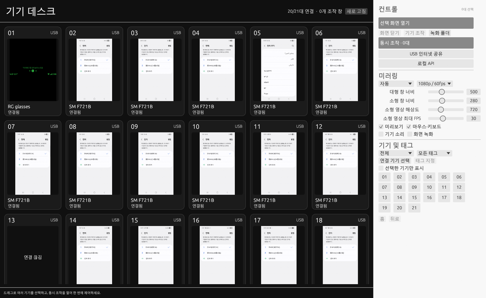
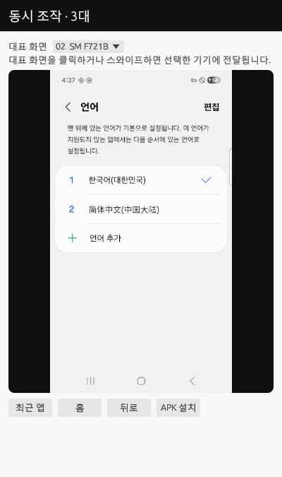
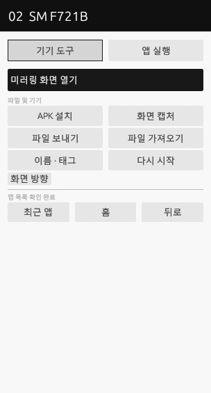
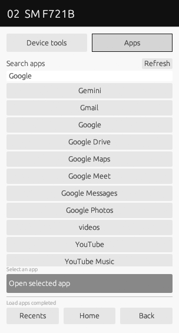
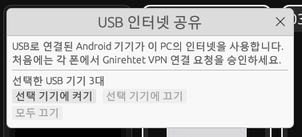
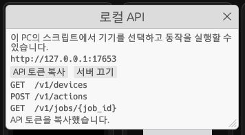

# Android Device Desk

[English](README.en.md) · [Windows 다운로드](https://github.com/hardline7/AndroidDeviceDesk/releases/latest)

**Android Device Desk는 Windows PC에서 여러 안드로이드 기기의 화면을 한눈에 보고 조작하는 데스크톱 앱입니다.** Windows 표시 언어가 한국어이면 한국어, 그 외에는 영어로 표시합니다. 기기 격자에서 폰을 드래그로 묶고, 대표 화면을 한 번 탭하거나 스와이프해 선택한 기기에 같은 입력을 전달할 수 있습니다. 한 대를 자세히 볼 때는 별도의 미러링 창과 기기 조작 패널을 엽니다.

> [v0.3.0 Windows 릴리스](https://github.com/hardline7/AndroidDeviceDesk/releases/tag/v0.3.0)에 작업 프리셋, 실패 기기 재실행, 새 컨트롤 패널과 도구 창이 포함됩니다.

## 실제 연결 화면

Windows에서 기기 데스크를 실행하고 USB로 연결한 Android 기기 화면을 촬영했습니다. 이미지를 누르면 크게 볼 수 있습니다.

[](docs/screenshots/dashboard-actual.png)

| 동시 조작 | 개별 기기 도구 | 앱 검색과 실행 |
| :---: | :---: | :---: |
| <a href="docs/screenshots/batch-control.png"></a> | <a href="docs/screenshots/device-tools.png"></a> | <a href="docs/screenshots/app-launcher.png"></a> |

| USB 인터넷 공유 | 작업 프리셋 | 자주 쓰는 동작 순서를 저장하고, 선택한 기기나 태그 그룹에서 실행합니다. 실행 결과에서 실패한 기기만 재실행할 수 있습니다. |
| 로컬 API |
| :---: | :---: |
| <a href="docs/screenshots/usb-internet.png"></a> | <a href="docs/screenshots/local-api.png"></a> |

## 주요 기능

| 기능 | 사용 방법 |
| --- | --- |
| 기기 격자 | 연결된 화면을 카드로 미리 봅니다. 연결이 끊겨도 저장된 번호와 이름이 남습니다. |
| 여러 대 선택 | 카드 영역을 마우스로 드래그합니다. Ctrl+드래그로 선택에 추가하거나 Shift+클릭으로 범위를 선택합니다. |
| 동시 조작 | 선택한 기기 중 대표 화면을 골라 탭과 스와이프를 전달합니다. 최근 앱, 홈, 뒤로, APK 일괄 설치도 지원합니다. |
| 개별 미러링 | 카드를 더블클릭하거나 **선택 화면 열기**를 누릅니다. 마우스와 키보드로 조작할 수 있습니다. |
| 개별 기기 도구 | 캡처, APK 설치, 다운로드 폴더 파일 전송, 회전 설정, 재시작, 앱 검색·실행을 지원합니다. |
| 보기 전용 및 녹화 | 마우스·키보드 제어를 끄고 미러링 창을 열면 보기 전용입니다. 지원되는 기기에서 소리를 전달하고 MKV로 녹화할 수 있습니다. |
| 기기 정리 | 번호, 별칭, 태그와 연결 방식으로 기기를 찾습니다. 창 너비, 해상도, 최대 FPS를 조정할 수 있습니다. |
| USB 인터넷 공유 | USB로 연결한 Android 기기에 PC의 인터넷을 공유합니다. 첫 연결 때 폰에서 VPN 요청을 승인합니다. |
| 로컬 API | 한 대, 여러 대, 전체 기기에 사이트 열기·앱 실행·탭·스와이프를 순서대로 보냅니다. [API 사용 안내](docs/API.md) |

## 다운로드와 첫 연결

1. [최신 릴리스](https://github.com/hardline7/AndroidDeviceDesk/releases/latest)의 **AndroidDeviceDesk.exe**를 다운로드합니다.
2. Windows 64비트 PC에서 EXE를 실행합니다. Python이나 별도 압축 해제는 필요하지 않습니다. 첫 실행 시 내장 엔진이 사용자 폴더에 준비됩니다.
3. 폰의 **개발자 옵션 → USB 디버깅**을 켭니다. 갤럭시에서는 일반적으로 **설정 → 휴대전화 정보 → 소프트웨어 정보**에서 **빌드번호**를 일곱 번 누르면 개발자 옵션이 나타납니다. 메뉴 이름은 모델과 시스템 언어에 따라 다를 수 있습니다.
4. 데이터 통신이 가능한 USB 케이블로 연결합니다. 폰 잠금을 해제하고 **USB 디버깅 허용** 요청을 승인합니다.
5. 카드가 표시되면 더블클릭해 미러링을 열어 봅니다. 상태가 갱신되지 않으면 **새로 고침**을 누릅니다.

USB 디버깅을 승인한 기기에서 사용하세요. Samsung 등 기기 제조사의 Windows USB 드라이버가 필요한 환경이 있습니다. 이미 ADB에 연결된 Wi-Fi 기기도 목록에 표시됩니다. 무선 디버깅의 새 페어링은 안드로이드의 무선 디버깅 화면과 ADB에서 먼저 설정합니다.

배포 파일의 SHA-256은 릴리스의 `SHA256SUMS.txt`와 비교할 수 있습니다.

```powershell
Get-FileHash .\AndroidDeviceDesk.exe -Algorithm SHA256
```

## 여러 기기를 한 번에 조작하기

1. 격자 위에서 드래그 사각형을 그려 연결된 기기를 두 대 이상 선택합니다. 오른쪽 번호 버튼으로 선택할 수도 있습니다.
2. 드래그를 마치면 **동시 조작** 창이 자동으로 열립니다. 번호 버튼으로 기기를 골랐다면 오른쪽 **동시 조작**을 누릅니다. 창이 열릴 때의 선택이 작업 대상으로 지정됩니다.
3. **대표 화면**을 선택합니다. 표시되는 폰 화면 안에서 클릭하면 탭을 보내고, 드래그하면 스와이프를 보냅니다. 진한 여백은 화면 입력 영역에서 제외됩니다.
4. 하단 버튼으로 **최근 앱**, **홈**, **뒤로**를 보낼 수 있습니다. **APK 설치**는 파일을 고르고 확인한 다음 실행됩니다.
5. 하단의 완료 수를 확인합니다. 대상 구성을 바꾸려면 격자에서 다시 드래그합니다.

탭과 스와이프는 대표 화면에서 누른 **상대 위치**를 각 기기의 화면 크기로 변환합니다. 같은 화면이나 같은 앱을 열어 놓으면 결과를 예측하기 쉽습니다. 화면 방향이 다른 기기는 해당 탭·스와이프에서 제외되고, 연결이 끊기거나 보기 전용인 기기에는 동시 조작 명령을 보내지 않습니다. 여러 기기 작업은 병렬로 처리되며 기기 상태에 따라 완료 시점이 다를 수 있습니다.

## 기기 한 대 조작과 화면 설정

- **기기 조작** 패널은 연결된 카드 하나를 선택하면 열립니다. 미러링을 시작하면 창 옆으로 이동합니다.
- **기기 도구**에서 캡처를 PNG로 저장하거나, APK를 설치하거나, 폰의 `Download` 폴더로 파일을 보내고 가져올 수 있습니다. 재시작은 확인 후 진행합니다.
- **앱 실행**에서는 앱 이름과 패키지 ID로 검색합니다. 주요 시스템 설정은 바로가기로 표시됩니다.
- 오른쪽의 **자동** 창 모드는 한 번에 세 대 이상을 열 때 소형 창 설정을 사용합니다. **대형**, **소형**을 지정할 수도 있습니다. 설정은 새로 연 미러링 창에 적용됩니다.
- **화면 녹화**를 켜고 미러링을 열면 `%USERPROFILE%\Videos\Android Device Desk` 아래에 MKV 파일이 저장됩니다. 녹화가 끝나면 미러링 창을 닫아 파일을 마무리합니다.
- **미리보기**를 끄면 격자 캡처가 멈춥니다. 동시 조작을 열면 입력 기준이 되는 대표 화면은 계속 갱신됩니다.

## USB로 PC 인터넷 공유하기

1. USB 디버깅을 승인한 기기를 하나 이상 선택합니다. PC 인터넷이 연결돼 있어야 합니다.
2. 오른쪽 **USB 인터넷 공유**에서 **선택 기기에 켜기**를 누릅니다. 처음에는 앱에 내장된 Gnirehtet 보조 앱을 선택한 폰에 설치합니다.
3. 각 폰의 잠금을 해제하고 **Gnirehtet VPN 연결 요청**을 승인합니다. 기기 데스크의 목록에서 **VPN 실행 중**을 확인합니다.
4. 폰의 Wi-Fi와 모바일 데이터가 꺼진 상태에서도 브라우저에서 웹사이트를 열 수 있습니다. 종료하려면 **선택 기기에 끄기** 또는 **모두 끄기**를 사용합니다.

PC와 USB 케이블이 연결돼 있고 기기 데스크가 실행 중이어야 합니다. Android의 VPN을 사용하므로 기존 VPN이 있는 기기에서는 전환이 필요할 수 있습니다. Gnirehtet은 IPv4 TCP·UDP를 전달합니다. USB를 뽑았다 다시 연결한 기기는 공유를 다시 켤 수 있습니다. [Gnirehtet 사용 안내](https://github.com/Genymobile/gnirehtet/tree/v2.5.1)

## 작업 프리셋과 실패 기기 재실행

1. 오른쪽 패널이나 **동시 조작** 창에서 **작업 프리셋 → 새 프리셋**을 누릅니다.
2. 이름을 입력하고 사이트 열기, 앱 실행, 탭, 스와이프, 키 입력, 대기를 필요한 순서로 추가해 저장합니다.
3. 격자에서 드래그로 고른 기기를 사용하거나 창에서 태그를 골라 대상과 대수를 확인한 뒤 실행합니다.
4. **실행 결과**에서 기기별 완료 단계와 실패 이유를 확인합니다. **실패한 기기만 재실행**을 누르면 해당 기기에서 원래 작업이 첫 단계부터 실행됩니다.

저장한 프리셋은 앱을 다시 열어도 남습니다. [로컬 API로 실행하고 재시도하기](docs/API.md#저장한-프리셋-실행-및-재시도--run-and-retry-saved-presets)

## 로컬 API 빠르게 시작하기

1. 기기 데스크 오른쪽에서 **로컬 API → 서버 켜기 → API 토큰 복사**를 누릅니다.
2. 이 PC의 PowerShell에서 기기 번호와 제어 가능 상태를 조회합니다.

```powershell
$api = 'http://127.0.0.1:17653'
$headers = @{ Authorization = 'Bearer ' + (Get-Clipboard -Raw).Trim() }
Invoke-RestMethod "$api/v1/devices" -Headers $headers
```

`POST /v1/actions`에 기기 번호 하나, 번호 목록, 또는 `"all"`을 보내면 사이트 열기, 앱 실행, 대기, 탭, 스와이프를 요청 순서대로 처리합니다. 반환된 `job_id`로 기기별 결과를 확인합니다. [API 사용 문서와 PowerShell 예제](docs/API.md)

## 구조와 데이터 저장

| 구성 | 역할 |
| --- | --- |
| Rust · egui/eframe | Windows UI, 미리보기 격자, 다중 선택, 설정, 기기 조작 패널 |
| ADB | 기기 검색, 기기별 화면 캡처, 키와 터치 입력, 앱 목록, APK 설치, 파일 전송 |
| scrcpy | 선택한 기기의 실시간 영상·오디오·제어 및 녹화 |
| 로컬 저장소 | 엔진 파일과 이름·태그·창 설정을 `%LOCALAPPDATA%\AndroidDeviceDesk`에 유지 |

앱은 기본 ADB 목록과 이미 실행 중인 로컬 보조 ADB 서버의 `127.0.0.1:5038` 목록을 합칩니다. 같은 기기가 두 목록에 나타나면 한 카드로 표시하고, 미리보기와 기기 조작을 해당 연결로 보냅니다. 기본 포트와 보조 포트가 나뉜 다기기 환경에서도 한 화면에서 관리할 수 있습니다. 보조 서버는 자동으로 시작하지 않습니다.

미리보기는 PC 메모리에서 처리됩니다. 캡처 및 녹화를 실행해 만든 파일은 PC에 저장됩니다. 앱 자체는 계정이나 클라우드 서비스 없이 동작하며, Wi-Fi ADB를 쓰면 화면과 명령은 설정한 기기 연결을 통해 이동합니다.

## 소스에서 빌드하기

Windows x64에서 [Rust](https://rust-lang.org/install/)와 [Visual Studio Build Tools](https://visualstudio.microsoft.com/downloads/)의 **Desktop development with C++** 워크로드를 설치합니다. Rust의 기본 Windows MSVC 도구 모음을 사용할 수 있습니다. 릴리스는 Rust 1.100 GNU 도구 모음으로 빌드했습니다.

```powershell
git clone https://github.com/hardline7/AndroidDeviceDesk.git
cd AndroidDeviceDesk
powershell -ExecutionPolicy Bypass -File .\scripts\build.ps1
```

스크립트는 공식 scrcpy와 Gnirehtet Windows 아카이브를 받고 SHA-256을 확인한 다음, 잠금 파일을 적용해 Rust 릴리스 빌드를 실행합니다. 산출물은 `dist\AndroidDeviceDesk.exe`입니다. 빌드 후 테스트를 실행할 수 있습니다.

```powershell
cargo test --locked --release --manifest-path .\rust-app\Cargo.toml
```

| 경로 | 설명 |
| --- | --- |
| `rust-app/src/main.rs` | 대시보드, 미리보기 격자, 드래그 선택, 창 및 설정 상태 |
| `rust-app/src/panel.rs` | 개별 기기 패널과 앱 검색·실행, 파일 도구 |
| `rust-app/src/batch.rs` | 대표 화면 입력, 화면 좌표 변환, 대상별 병렬 실행 |
| `rust-app/src/engine.rs` | 내장 엔진 준비, ADB 검색·라우팅, 이미지 캡처, 미러링 창 연동 |
| `rust-app/src/tether.rs` | Gnirehtet 중계와 USB 역테더링 시작·중지·상태 확인 |
| `scripts/build.ps1` | 공식 런타임 다운로드·해시 검증 및 단일 EXE 빌드 |

## 연결 문제 해결

| 증상 | 확인할 내용 |
| --- | --- |
| 연결된 폰이 보이지 않음 | 데이터 케이블, USB 포트, 제조사 드라이버, 폰의 USB 디버깅 승인을 확인합니다. |
| 카드가 오프라인으로 표시됨 | 폰 잠금을 해제하고 USB를 다시 연결한 뒤 **새로 고침**을 누릅니다. 저장된 카드에는 이전 번호가 유지됩니다. |
| 여러 대 중 일부만 표시됨 | 연결 방식과 태그 필터를 확인합니다. 보조 ADB 서버를 사용하는 구성에서는 서버가 실행 중인지 확인합니다. |
| 미리보기 또는 미러링 화면이 검음 | 화면 잠금 상태와 앱의 화면 캡처 제한을 확인합니다. |
| 동시 조작 버튼이 비활성화됨 | 연결된 제어 가능 기기를 두 대 이상 선택하고 **마우스·키보드** 제어를 켭니다. |
| 여러 폰에서 탭 결과가 다름 | 같은 화면 상태와 방향을 맞춥니다. 좌표는 각 기기의 해상도에 맞춰 변환됩니다. |
| 소리가 안 들림 | 새 창을 열기 전에 **기기 소리**를 켭니다. 오디오 캡처는 안드로이드 버전과 앱 정책의 영향을 받습니다. |

## 포함된 구성 요소와 출처

자체 작성한 코드, 빌드 스크립트, 문서는 [Apache-2.0](LICENSE)으로 공개합니다. [프로젝트 고지](NOTICE)와 [EXE 배포 조건 및 호환 DLL 교체 방법](docs/DISTRIBUTION.md)을 함께 확인할 수 있습니다.

EXE는 [Genymobile scrcpy 5.0.1 Windows 배포본](https://github.com/Genymobile/scrcpy/releases/tag/v5.0.1)을 사용합니다. 이 소프트웨어는 LGPL 2.1 이상으로 제공되는 [FFmpeg 9.0.2](https://ffmpeg.org/) 코드를 사용합니다. 대응 소스 코드는 [릴리스의 third-party-sources.zip](https://github.com/hardline7/AndroidDeviceDesk/releases/latest)에서 받을 수 있습니다. 구성 요소 버전, 라이선스 및 원본 빌드 스크립트는 [THIRD_PARTY.md](THIRD_PARTY.md)에 정리했습니다.
